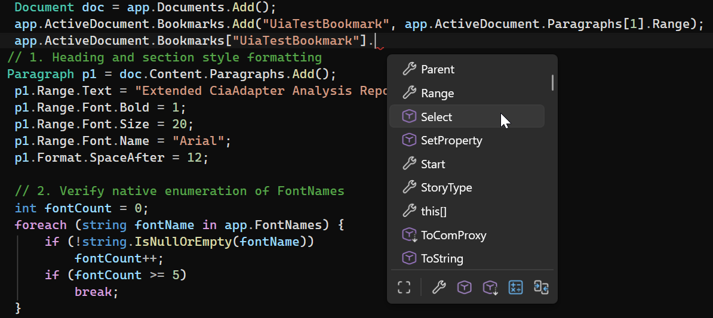
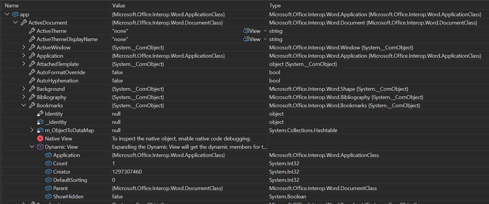

[](https://dotnet.microsoft.com/)
[](https://dotnet.microsoft.com/)
[](https://dotnet.microsoft.com/)
[](https://dotnet.microsoft.com/)
[](https://dotnet.microsoft.com/)
[](https://dotnet.microsoft.com/)
[](https://microsoft.com/windows)
[](LICENSE)
[](https://www.nuget.org/packages/UIAGen)
[](https://www.nuget.org/packages/UIAGen)
[](https://github.com/PiotrFilipowicz/UIAGen/releases)

# Universal Interop Assembly (UIA) Code Generator

**Build-time code generator (`UIAGen.exe`)** turns any Windows COM Type Library into a clean, statically typed, **Native AOT-compatible C# adapter** for .NET 8/9/10/11 and .NET Standard 2.0 (including .NET Framework 4.8).

Say goodbye to Primary Interop Assemblies (PIA), GAC deployment nightmares, and the slow C# `dynamic` binder.

---

## What is it for?

Windows runs on COM — from Microsoft Office, Adobe Creative Cloud, and Autodesk AutoCAD to industrial CAD, ERP systems, and core OS automation. Yet modern .NET left developers behind without a modern `tlbimp.exe`, forcing teams to either stay stuck on .NET Framework 4.8 or write painful, error-prone interop wrappers by hand.

**UIA bridges that gap.** Point `UIAGen` at any `.tlb`, `.dll`, `.exe`, or registered `ProgID` (like `Word.Application`, `InDesign.Application`, or `AutoCAD.Application`), and get ready-to-compile, statically typed C# classes with full Visual Studio IntelliSense, full debugger support, and compile-time type safety.

---

## How UIAGen Compares

| Feature | Legacy `tlbimp.exe` / PIA | C# `dynamic` | Manual `ComWrappers` | **UIAGen** |
| :--- | :---: | :---: | :---: | :---: |
| **.NET 8/9/10/11 Support** | ⚠️ Limited (No `tlbimp`) | ✅ Yes | ✅ Yes | ✅ **Native** |
| **.NET Framework 4.8 (`net48`) Support** | ✅ Yes (with PIA/GAC) | ✅ Yes | ❌ No | ✅ **Yes (`netstandard2.0`, zero PIA)** |
| **Native AOT & Trimming** | ❌ Broken | ❌ Broken | ✅ Yes | ✅ **100% Compatible** |
| **Zero Manual Boilerplate** | ✅ Auto-generated | ✅ No wrappers | ❌ Painful to write | ✅ **1-Command CLI** |
| **Full IntelliSense & Type Safety** | ✅ Yes | ❌ Runtime only | ✅ Yes | ✅ **Strongly Typed** |
| **No GAC / PIA Versioning Hell** | ❌ Brittle | ✅ Yes | ✅ Yes | ✅ **Self-Contained** |
| **Deterministic COM Cleanup** | ⚠️ GC-dependent | ⚠️ GC-dependent | ⚠️ Manual | ✅ **Built-in `Tracker`** |

---

## Why is UIA unique?

* **True Native AOT & Trimming Support:** Unlike legacy RCW/CCW interop, UIA generates static C# wrappers that call native COM vtables directly—compiling cleanly into standalone Native AOT executables.
* **Works on `.NET Framework 4.8` Too:** Generated adapter projects multi-target `net8.0;netstandard2.0`, and the test suite passes under `net48` as well—making UIA a drop-in, PIA-free upgrade path even if you cannot migrate off .NET Framework 4.8 yet.
* **Zero PIA & Zero `dynamic`:** Ship your application without hunting for version-specific Primary Interop Assemblies or sacrificing performance and type safety to `dynamic`.
* **Proven Compilation Across 500+ COM Servers:** Tested at scale against more than 500 registered Windows system COM libraries, as well as massive, real-world object models like Microsoft Office, Adobe InDesign, and Autodesk AutoCAD.
* **Smart Static Typing:** Infers strongly typed collection elements (`Stories` → `Story`), provides runtime polymorphic casting (`As<T>()`), and cleanly separates missing COM objects from failed `HRESULT`s.
* **Deterministic Memory Control:** Built-in reference lifecycle tracking (`Tracker` / `Dispose`) ensures COM servers actually close when your code finishes—no lingering zombie processes in Task Manager.

---

## Why VBA Still Survives—and How UIA Ends "PIA Reference Hell"

People often ask why 30-year-old **VBA** remains so entrenched in Office, Access, and AutoCAD automation—even among experienced C# teams. Technologically, VBA and modern .NET sit on opposite ends of the spectrum:

| Dimension | VBA (1990s Scripting) | Legacy PIA (.NET Interop) | **UIA (.NET 8–11 + Native AOT)** |
| :--- | :--- | :--- | :--- |
| **Runtime & Compilation** | Interpreted / p-code scripting inside host documents | JIT-only managed code (breaks Native AOT & trimming) | **Statically compiled C#, full Native AOT support** |
| **Type System** | Dynamic / `Variant`-heavy, weak compile-time guarantees | Static types (on brittle, version-locked PIAs) | **Static C# types, zero PIA, zero `dynamic`** |
| **Tooling & Engineering** | Legacy VBE editor only—no Visual Studio, no refactoring, no Roslyn, no CI/CD or NuGet | Visual Studio IDE & modern tooling | **Full Visual Studio IDE, IntelliSense, debugger views, Roslyn, Git, CI/CD, NuGet** |
| **COM Lifetime & Cleanup** | ✅ Deterministic scope-based ref-counting | ❌ GC-bound RCWs ("two-dots rule" leaks & zombies) | ✅ **Deterministic LIFO `Tracker` + loop checkpoints** |

Developers do **not** stay on VBA because they enjoy writing dynamic, untyped scripts trapped inside an embedded 1990s macro editor without Visual Studio, refactoring, automated testing, or native compilation. They stay on VBA for **one reason**: COM object models were designed around VBA's deterministic reference counting. In VBA, expressions like `app.DBEngine.Workspaces(0)` and `rs.Fields("Label").Value` release every temporary COM pointer **the instant** the expression or loop scope ends.

When .NET introduced Primary Interop Assemblies (PIAs), it gave developers Visual Studio and static types—but broke COM lifetime management by replacing deterministic teardown with a Garbage Collector that only sees a ~32-byte Runtime Callable Wrapper (RCW) on the managed heap, completely blind to the entire `MSACCESS.EXE` or `EXCEL.EXE` process locked on the other side. Under PIA's infamous **two-dots rule**, natural C# chaining silently leaks hidden RCWs that keep out-of-process COM servers alive as unclosable zombie windows holding `.accdb` / `.laccdb` file locks.

Compare all three worlds on a real **1,000-row Access DAO transaction**:

```vb
' 🟡 VBA: Deterministic COM cleanup, but trapped in a dynamic 1990s scripting runtime
'    without Visual Studio, static type guarantees, modern libraries, or Native AOT.
Set ws = app.DBEngine.Workspaces(0)
ws.BeginTrans
Set rs = db.OpenRecordset("BenchItems")
For i = 0 To 999
    rs.AddNew
    rs.Fields("Label").Value = "Row " & i
    rs.Update
Next i
ws.CommitTrans
```

```csharp
// ❌ PIA (.NET): Gives you Visual Studio, but breaks Native AOT and turns COM cleanup into a nightmare.
//    Even with 5 explicit Marshal.FinalReleaseComObject calls, MSACCESS.EXE STILL hangs!
var accessType = Type.GetTypeFromProgID("Access.Application", throwOnError: true);
var app = (Access.Application)Activator.CreateInstance(accessType);
app.OpenCurrentDatabase(_dbPath);
var db = app.CurrentDb();
var ws = app.DBEngine.Workspaces[0]; // ⚠️ Leaks 2 hidden RCWs: DBEngine + Workspaces!

ws.BeginTrans();
var rs = db.OpenRecordset("BenchItems");
for (int i = 0; i < 1000; i++)
{
    rs.AddNew();
    var field = rs.Fields["Label"];  // ⚠️ Leaks 1,000 hidden RCWs for rs.Fields!
    field.Value = $"Row {i}";
    Marshal.FinalReleaseComObject(field);
    rs.Update();
}
rs.Close();
Marshal.FinalReleaseComObject(rs);
ws.CommitTrans();
Marshal.FinalReleaseComObject(ws);

app.CloseCurrentDatabase();
Marshal.FinalReleaseComObject(db);
app.Quit(Access.AcQuitOption.acQuitSaveNone);
Marshal.FinalReleaseComObject(app);
// Result: 1,002 leaked intermediate RCWs keep MSACCESS.EXE alive, unclosable by hand,
// and locking the database until your process exits or runs GC.Collect() + WaitForPendingFinalizers().
```

To survive this in PIA, you must abandon readable C# and hoist **every single property dot** (`dbEngine`, `workspaces`, `fields`) into separate variables inside nested `try/finally` blocks. **UIA bridges the technological divide completely—giving you a modern, statically typed, Native AOT-compilable C# codebase in Visual Studio *with* VBA-grade deterministic COM cleanup:**

```csharp
// ✅ UIA (.NET 8–11 / Native AOT): Full Visual Studio IntelliSense, static types, Native AOT,
//    VBA-grade chaining, and deterministic LIFO cleanup — zero zombies.
using var app = Adapter.Office.Access.Application.Create("Access.Application");
app.Visible = false;
app.OpenCurrentDatabase(_dbPath);
var db = app.CurrentDb();
var ws = app.DBEngine.Workspaces[0];

ws.BeginTrans();
var rs = db.OpenRecordset("BenchItems");

var tracker = app.ComBehavior!.Tracker;
for (int i = 0; i < 1000; i++)
{
    int cp = tracker.GetCheckPoint();
    rs.AddNew();
    rs.Fields["Label"].Value = $"Row {i}";
    rs.Update();
    tracker.MoveCheckPoint(cp); // Optional in small loops: frees temporary Fields/Field handles per iteration (O(1) even at 100,000+ rows).
}
ws.CommitTrans();

rs.Close();
app.CloseCurrentDatabase();
app.Quit(); // Releases remaining tracked COM wrappers (ws, Workspaces, DBEngine, rs, db) in LIFO order before COM Quit.
```

Even without checkpoints, `app.Quit()` clears the LIFO `Tracker` so `MSACCESS.EXE` shuts down cleanly with zero locked files. Adding `GetCheckPoint()` / `MoveCheckPoint(cp)` mirrors a VBA loop scope directly—keeping active COM handles constant (`O(1)`) whether you insert 1,000 or 100,000 rows, inside a true compiled, statically typed .NET / Native AOT application. See **[LIFO Reference Tracking in ARCHITECTURE.md](ARCHITECTURE.md#own-native-references-and-marshal-values-explicitly)** for details.

---

## Performance Benchmarks: Out-of-Process UIA vs. Early-Bound PIA

A common assumption is that early-bound PIA vtable calls must always outperform `IDispatch::Invoke`. In **out-of-process COM** (Access, Excel, Outlook, PowerPoint, Word), BenchmarkDotNet measurements across equivalent real-world workloads show the opposite in call-intensive loops:

| Benchmark Scenario | PIA Mean | UIA Mean | UIA Time (% of PIA) | Speedup |
| :--- | ---: | ---: | ---: | :---: |
| `Outlook_EnumerateInbox_Table` | 4.157 s | **1.186 s** | **29%** | **3.5× faster** |
| `Outlook_EnumerateInbox_ItemsLoop` | 6.808 s | **3.381 s** | **50%** | **2.0× faster** |
| `Excel_WriteCells_Chatty` | 6.526 s | **3.742 s** | **57%** | **1.7× faster** |
| `Access_Insert1000Rows_DaoTransaction` | 10.420 s | **6.631 s** | **64%** | **1.6× faster** |
| `PowerPoint_Create30Slides_AndExport` | 5.281 s | **4.619 s** | **89%** | **1.1× faster** |
| `Word_Create500Paragraphs_AndExport` | 3.510 s | **3.248 s** | **93%** | **1.1× faster** |
| `Excel_WriteCells_Batched2DArray` | **1.580 s** | 1.626 s | **103%** | Parity |

*(Note: PIA was tested with full early-bound interfaces and meticulous manual `Marshal.ReleaseComObject` cleanup for every intermediate variable so processes exited cleanly).*

### Why UIA beats early-bound PIA in chatty out-of-process loops

1. **Out-of-process vtables still marshal across LRPC:** Early-bound PIA calls do not jump directly in memory across process boundaries—they travel through the TypeLib *Universal Marshaler* and CLR RCW plumbing (`RCWCache` lookups, multi-interface `QueryInterface` probes such as `IMarshal`/`IProvideClassInfo`/`_MailItem`, and multi-interface teardown on `Marshal.ReleaseComObject`).
2. **Direct `IDispatch` with compile-time `DISPID`s:** In `InvokeMode.Early`, `UIAGen` bakes `DISPID`s directly into generated wrappers (skipping `GetIDsOfNames`) and invokes `IDispatch::Invoke` via `delegate* unmanaged[Stdcall]` (`calli`) with stack-allocated `VARIANT` slots—holding just one native `IDispatch*` pointer per wrapper and resolving/checking types locally in C# without cross-process `QueryInterface`.
3. **Engine-bound workloads match PIA:** When most time is spent inside a single 2D array transfer (`Excel_WriteCells_Batched2DArray`, where UIA also uses less managed memory: `48 KB` vs `128 KB`) or document export (`Word`, `PowerPoint`), both wait on the Office process itself—while UIA still removes PIA/GAC dependencies, Native AOT blockers, and RCW reference leaks.

---

## .NET Framework 4.8 (`net48`) Support

If your application cannot yet migrate away from **.NET Framework 4.8 (`net48`)**, you can still use generated UIA adapters without PIAs or GAC dependencies:

* **Multi-targeted output (`net8.0;netstandard2.0`):** Every generated adapter project targets both `net8.0` and `netstandard2.0`, and the test suite passes on `net48`. Your `net48` application can reference the `netstandard2.0` adapter build directly (or compile the generated sources with `<AllowUnsafeBlocks>true</AllowUnsafeBlocks>`).
* **Single-assembly merging & trimming with `ILMerge`:** On `net48`, you can merge and trim/internalize the generated adapter assembly into your application binary using **ILMerge**, keeping deployment self-contained and ready for a smooth future migration to .NET 8 and Native AOT.

---

## Quick Start

```bash
# 1. Install the generator
dotnet tool install -g UIAGen

# 2. Generate a C# adapter (and optionally compile to .dll with -compile)
uiagen Word.Application ./WordUIA WordAdapter
uiagen InDesign.Application,InCopy.Application ./AdobeUIA AdobeAdapter
uiagen AutoCAD.Application ./AutoCADUIA AutoCADAdapter
uiagen -acad ./AcadUIA AcadAdapter -compile
uiagen -adobe ./AdobeUIA AdobeAdapter -compile
uiagen -mso ./MSOfficeUIA MSOfficeAdapter -compile
```

```csharp
// 3. Automate with full IntelliSense, debugger application tree full view, and Native AOT support
using MSOfficeAdapter.Word;

using var app = Application.Create("Word.Application");
using var doc = app.Documents.Add();
doc.Content.Paragraphs.Add().Range.Text = "Hello from Native AOT!";
Bookmarks bookmarks = doc.Bookmarks;
Bookmark bookmark = bookmarks.Add("UiaTestBookmark", doc.Paragraphs[1].Range);
string bookmarkName = bookmarks["UiaTestBookmark"].Name;
doc.Close(WdSaveOptions.wdDoNotSaveChanges);
app.Quit(WdSaveOptions.wdDoNotSaveChanges);
```
IntelliSense in UIA



QuickWatch Window in UIA

 

QuickWatch Window in PIA



Size of Adobe UIA Adapter of 41 libraries is 4.73 MB
Size of AutoCAD UIA Adapter of 22 libraries is 2.26 MB

---

## Autodesk AutoCAD & CAD Automation

`UIAGen` resolves multi-resource binaries (`acad.exe`), split `Common Files\Autodesk Shared` type libraries (`acax*.tlb`, `axdb*.tlb`), and implicit `MSForms` (`FM20.DLL`) dependencies automatically:

```bash
# List or generate & compile adapters for all installed Autodesk COM libraries
uiagen -all -filter "C:\Program Files\Autodesk,C:\Program Files\Common Files\Autodesk Shared" -list
uiagen -all ./AutodeskUIA -filter "C:\Program Files\Autodesk,C:\Program Files\Common Files\Autodesk Shared" -compile
uiagen -acad ./AutodeskUIA -compile
```

See the **[AutoCAD Type Library Dependency Graph Case Study](ARCHITECTURE.md#case-study-autodesk-autocad-com-type-library-dependency-graph)** in `ARCHITECTURE.md` for a full breakdown of the 22 Autodesk COM libraries and their cross-library dependencies.

---

## Deep Dive

* **Technical Architecture & CLI Reference:** Ready to see how vtable binding, `VARIANT` stack marshaling, and debugger proxies work under the hood? Read **[ARCHITECTURE.md](ARCHITECTURE.md)**.

## License & Commercial Terms

`UIAGen` is dual-licensed to support both open-source and commercial development while preserving authorship attribution:

* **Generator (`UIAGen`):** Licensed under the **GNU Lesser General Public License v3 (LGPLv3)**. See [LICENSE](LICENSE) and [LICENSE.GPL](LICENSE.GPL).
* **Generated Output (`Code Generation Exception`):** Under the [Code Generation Exception](EXCEPTION), you may compile, use, and distribute the generated adapter code in proprietary or open-source projects under terms of your choice, **provided that**:
  1. All generated C# source files retain the original copyright and attribution headers (`Generated by UIAGen` / Piotr Filipowicz).
  2. Any binary or commercial distribution using the generated adapters includes a visible acknowledgment of **UIAGen by Piotr Filipowicz** (with a link to this repository) in its documentation, "About" section, or `THIRD-PARTY-NOTICES.txt`.
* **Commercial / White-Label Licensing:** Need to redistribute or modify `UIAGen` without LGPLv3 obligations, require white-label output without attribution notices, or need priority enterprise support and custom COM adapter integrations? Contact the author (**Piotr Filipowicz**) via [GitHub](https://github.com/PiotrFilipowicz) to obtain a commercial license.
