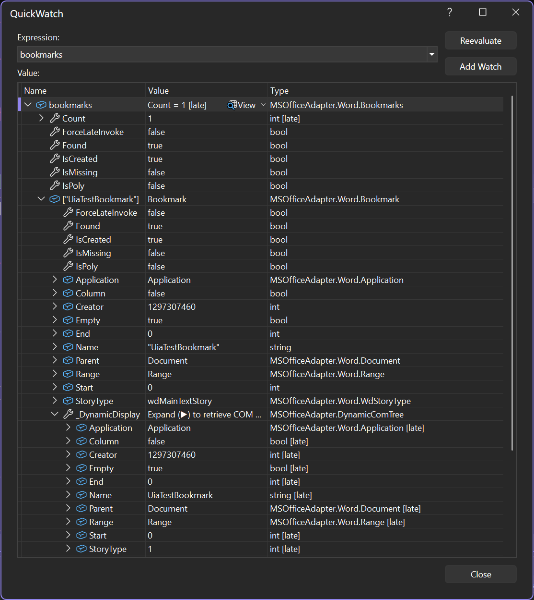

[](https://dotnet.microsoft.com/)
[](https://microsoft.com/windows)
[](LICENSE)

# Universal Interop Assembly (UIA) Code Generator

**Build-time code generator (`UIAGen.exe`)** turns any Windows COM Type Library into a clean, statically typed, **Native AOT-compatible C# adapter** for .NET 10.

Say goodbye to Primary Interop Assemblies (PIA), GAC deployment nightmares, and the slow C# `dynamic` binder.

---

## What is it for?

Windows runs on COM — from Microsoft Office, Adobe Creative Cloud, and Autodesk AutoCAD to industrial CAD, ERP systems, and core OS automation. Yet modern .NET left developers behind without a modern `tlbimp.exe`, forcing teams to either stay stuck on .NET Framework 4.8 or write painful, error-prone interop wrappers by hand.

**UIA bridges that gap.** Point `UIAGen` at any `.tlb`, `.dll`, `.exe`, or registered `ProgID` (like `Word.Application`, `InDesign.Application`, or `AutoCAD.Application`), and get ready-to-compile, statically typed C# classes with full Visual Studio IntelliSense, full debugger support, and compile-time type safety.

---

## How UIAGen Compares

| Feature | Legacy `tlbimp.exe` / PIA | C# `dynamic` | Manual `ComWrappers` | **UIAGen** |
| :--- | :---: | :---: | :---: | :---: |
| **.NET 8 / 9 / 10 Support** | ⚠️ Limited (No `tlbimp`) | ✅ Yes | ✅ Yes | ✅ **Native** |
| **Native AOT & Trimming** | ❌ Broken | ❌ Broken | ✅ Yes | ✅ **100% Compatible** |
| **Zero Manual Boilerplate** | ✅ Auto-generated | ✅ No wrappers | ❌ Painful to write | ✅ **1-Command CLI** |
| **Full IntelliSense & Type Safety** | ✅ Yes | ❌ Runtime only | ✅ Yes | ✅ **Strongly Typed** |
| **No GAC / PIA Versioning Hell** | ❌ Brittle | ✅ Yes | ✅ Yes | ✅ **Self-Contained** |
| **Deterministic COM Cleanup** | ⚠️ GC-dependent | ⚠️ GC-dependent | ⚠️ Manual | ✅ **Built-in `Tracker`** |

---

## Why is UIA unique?

* **True Native AOT & Trimming Support:** Unlike legacy RCW/CCW interop, UIA generates static C# wrappers that call native COM vtables directly—compiling cleanly into standalone Native AOT executables.
* **Zero PIA & Zero `dynamic`:** Ship your application without hunting for version-specific Primary Interop Assemblies or sacrificing performance and type safety to `dynamic`.
* **Proven Compilation Across 500+ COM Servers:** Tested at scale against more than 500 registered Windows system COM libraries, as well as massive, real-world object models like Microsoft Office, Adobe InDesign, and Autodesk AutoCAD.
* **Smart Static Typing:** Infers strongly typed collection elements (`Stories` → `Story`), provides runtime polymorphic casting (`As<T>()`), and cleanly separates missing COM objects from failed `HRESULT`s.
* **Deterministic Memory Control:** Built-in reference lifecycle tracking (`Tracker` / `Dispose`) ensures COM servers actually close when your code finishes—no lingering zombie processes in Task Manager.

---

## Quick Start

```bash
# 1. Install the generator
dotnet tool install -g UIAGen

# 2. Generate a C# adapter (and optionally compile to .dll with -compile)
uiagen Word.Application ./WordUIA WordAdapter
uiagen InDesign.Application,InCopy.Application ./AdobeUIA AdobeAdapter
uiagen AutoCAD.Application ./AutoCADUIA AutoCADAdapter
uiagen -acad ./AcadUIA AcadAdapter -compile
uiagen -adobe ./AdobeUIA AdobeAdapter -compile
uiagen -mso ./MSOfficeUIA MSOfficeAdapter -compile
```

```csharp
// 3. Automate with full IntelliSense, debugger application tree full view, and Native AOT support
using MSOfficeAdapter.Word;

using var app = Application.Create("Word.Application");
using var doc = app.Documents.Add();
doc.Content.Paragraphs.Add().Range.Text = "Hello from Native AOT!";
Bookmarks bookmarks = doc.Bookmarks;
Bookmark bookmark = bookmarks.Add("UiaTestBookmark", doc.Paragraphs[1].Range);
string bookmarkName = bookmarks["UiaTestBookmark"].Name;
doc.Close(WdSaveOptions.wdDoNotSaveChanges);
app.Quit(WdSaveOptions.wdDoNotSaveChanges);
```


 


Size of Adobe UIA Adapter of 41 libraries is 4.73 MB
Size of AutoCAD UIA Adapter of 22 libraries is 2.26 MB

---

## Autodesk AutoCAD & CAD Automation

`UIAGen` resolves multi-resource binaries (`acad.exe`), split `Common Files\Autodesk Shared` type libraries (`acax*.tlb`, `axdb*.tlb`), and implicit `MSForms` (`FM20.DLL`) dependencies automatically:

```bash
# List or generate & compile adapters for all installed Autodesk COM libraries
uiagen -all -filter "C:\Program Files\Autodesk,C:\Program Files\Common Files\Autodesk Shared" -list
uiagen -all ./AutodeskUIA -filter "C:\Program Files\Autodesk,C:\Program Files\Common Files\Autodesk Shared" -compile
uiagen -acad ./AutodeskUIA -compile
```

See the **[AutoCAD Type Library Dependency Graph Case Study](ARCHITECTURE.md#case-study-autodesk-autocad-com-type-library-dependency-graph)** in `ARCHITECTURE.md` for a full breakdown of the 22 Autodesk COM libraries and their cross-library dependencies.

---

## Deep Dive

* **Technical Architecture & CLI Reference:** Ready to see how vtable binding, `VARIANT` stack marshaling, and debugger proxies work under the hood? Read **[ARCHITECTURE.md](ARCHITECTURE.md)**.

## License

* **Generator (`UIAGen`):** GNU Lesser General Public License v3. See [LICENSE](LICENSE) and [LICENSE.GPL](LICENSE.GPL).
* **Generated output:** The [Code Generation Exception](EXCEPTION) permits distribution of the generated output under terms of your choice, subject to the exception's scope. It does not relicense the generator itself.